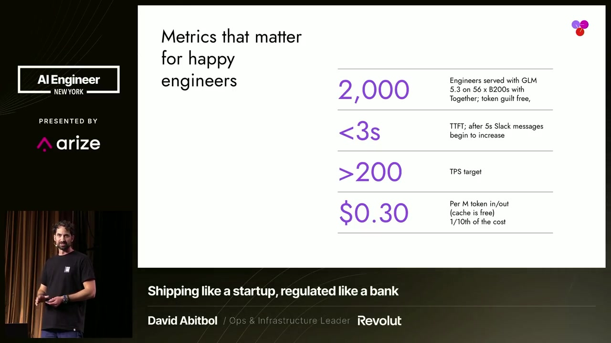
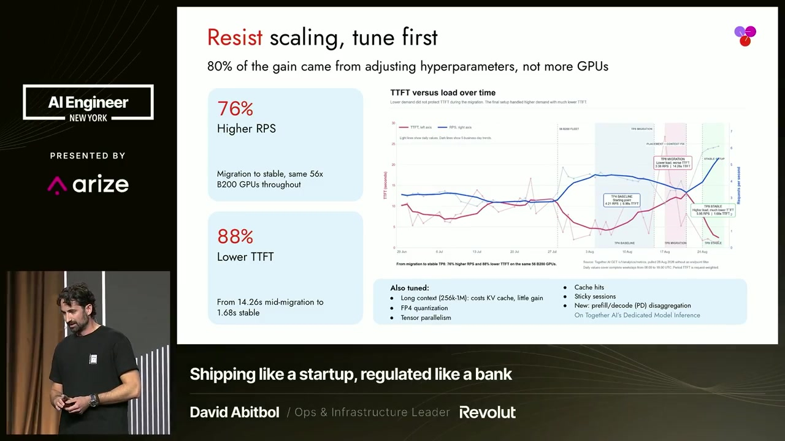
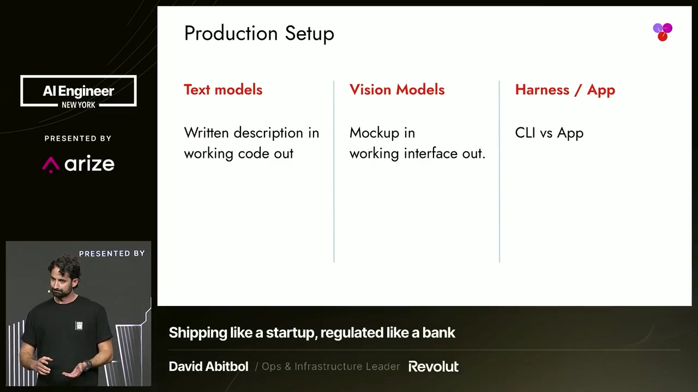
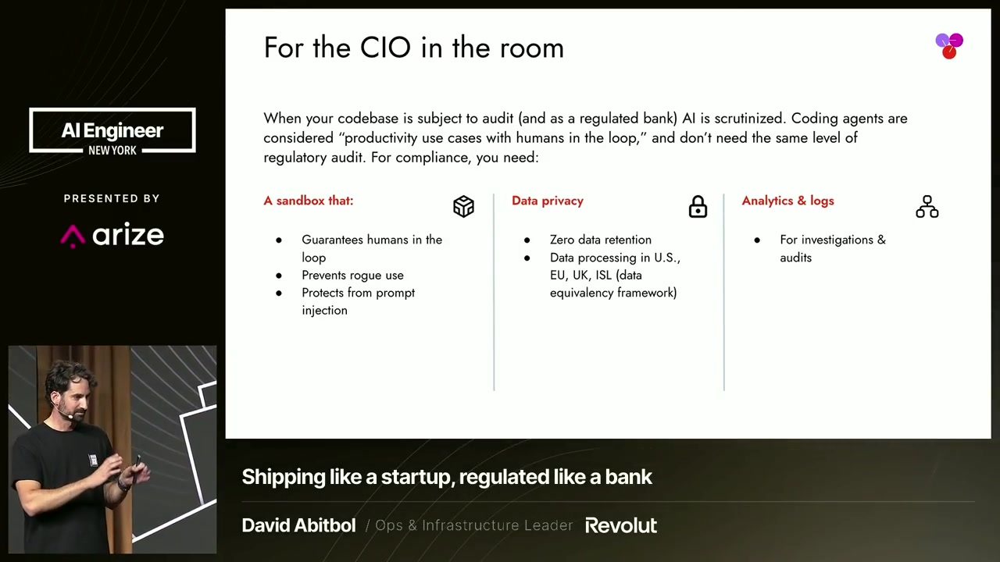

I watched ["How Revolut Cut AI Coding Costs 90% With Self-Hosted Open Models"](https://www.youtube.com/watch?v=Ok6QdZHCcI8) — David Abitbol, who leads AI operations at Revolut, speaking at AI Engineer New York. His framing: *"Shipping like a startup, regulated like a bank."* It is a dense technical talk, and almost every number in it is relevant to anyone running local models for agentic coding, so here are the points that matter.

## The rollout, with receipts

Revolut (80M customers, 45 markets) tracked a sample of 2,000 engineers for about a year:

| Period | Tool | Lead time | Coding time |
|---|---|---|---|
| Jan 2025 | Gemini | +10% | +20% |
| Feb 2025 – Jan 2026 | Claude Code | minimal at launch | minimal at launch |
| Apr 2026 | Self-hosted GLM 5.1 | **+70%** | **+60%** |

Two details worth pausing on. First, Claude Code showed little *measurable* impact at first while engineers were spending $1,000–$10,000/month, which is why the rollout came with strict budget caps. Second, the asymmetry of the GLM numbers: the bigger gain landed on **lead time**, not coding time. His explanation is that the bottleneck in engineering is not typing code — it is the surrounding work (inbox triage, Jira, Confluence). When tokens are effectively unlimited, engineers stop rationing them for the hardest task or the end of the quarter.

The current posture: self-hosted open source is the default, billing is flat with no month-to-month bill shock, and frontier models (Codex, Claude Code, Gemini) are the exception for the hardest tasks.

## The economics

The capacity math: serving 2,000 engineers on GLM 5.3 — an 800-billion-parameter model — takes roughly **56 B200 GPUs** (dedicated, hosted with Together AI). The headline numbers:

- **$0.30 per million tokens blended** (in/out, cache is free) — the invoice is **one tenth** of what they were paying Anthropic and OpenAI.
- Latency targets are empirical, not theoretical: **TTFT under 3 seconds**, because past 5 seconds *"my Slack inbox starts to blow up."*
- **Throughput barely matters** for interactivity: 200 TPS is fine, because engineers now run tasks in parallel and check back when they finish instead of watching tokens stream. After 5 p.m., when the GPUs are idle, they get 800 TPS.

## Resist scaling, tune first

This is the slide I would tattoo on the ops team's wall:

80% of the performance gain came from adjusting hyperparameters, **not more GPUs**. Same 56 B200s from April to August: requests per second up 76% (3 → 7+) and time-to-first-token down 88% (14.26s → 1.68s stable). Dropping weights onto GPUs and calling it a day produces terrible performance; the configuration is the product.

His tuning checklist, roughly in order of contrarian value:

- **Long context is a scam.** Even if the model advertises 1M tokens, the workload needs 256K — and serving more costs KV cache for little gain.
- **FP4 is the floor on Blackwell.** Going from FP4 to FP8 costs about 40% more GPU footprint for zero precision gain.
- **Tensor parallelism**: GLM fits on TP4, but the KV cache runs short; TP8 may serve better depending on workload.
- **Cache hit rate above 90%** for coding tasks — this is why sticky sessions matter.
- Plus speculative decoding and prefill/decode (PD) disaggregation.

## Take the smarter model, route vision elsewhere

GLM is text-only, and he treats that as an acceptable trade-off rather than a blocker: *"we would make [that trade-off] every time"* — get the smarter model and handle image recognition another way. A local router (they use OpenCode) sends image tasks to Gemini while GLM handles the main coding work. For teams that need vision directly, GLM's Flash variant works well; their UI designer uses it and UI product turnaround improved substantially. All endpoints are OpenAI-compatible, which is what plugs into OpenCode, Codex and friends — compatibility is the feature he recommends optimizing for.

## The compliance answer for Chinese open weights

Revolut is an EU-regulated bank running Chinese open-weight models, and the argument to regulators is clean:

- **Weights only, no inference to China.** They download the weights and run them on US-based infrastructure — *"for data sharing side, this is totally fine."*
- **Coding agents are not autonomous agents.** A human is always in the loop, and the sandbox is built to guarantee it: allow/deny rules per operation (allow `grep`, deny `gradle`, for instance). That classification — "productivity use case with humans in the loop" — is what keeps it out of the heaviest regulatory audit.
- The sandbox does double duty: it also shields against rogue internal use (*"you'd be surprised what you find in a large company"*) and prompt injection, which he considers less of a threat now that models are smarter, but still a live one.
- **Data privacy**: GPUs can sit in any country in the data equivalency framework (US, EU, UK, Israel); GPU and inference providers have zero data retention by default.
- **Strong OpenTelemetry** so any incident can be traced through deep logs.

## The through-line

The cost win and the compliance win come from the same discipline: **constrain the system tightly** — cap context, cap precision, cap permissions — instead of buying more capacity or a bigger model. The open question the talk leaves hanging is durability: these are one company's internal numbers, the 1/10 cost figure assumes frontier API pricing holds, and nobody knows yet whether regulators will accept the human-in-the-loop sandbox argument as a general precedent or a Revolut-specific arrangement.

---

*Talk: [How Revolut Cut AI Coding Costs 90% With Self-Hosted Open Models](https://www.youtube.com/watch?v=Ok6QdZHCcI8) — David Abitbol, Revolut @ AI Engineer. Slides captured from the video.*
